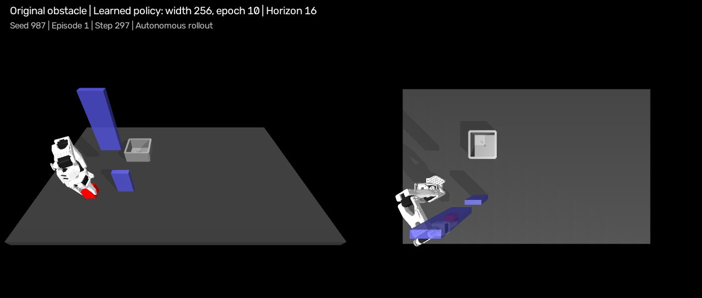
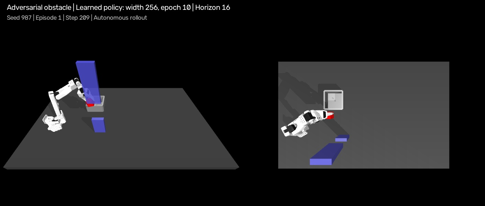

# SO-101 Behavioral Cloning Lab

Learning robot pick-and-place from human demonstrations in MuJoCo, building on
the [ETH Zürich Robot Learning imitation-learning assignment](https://github.com/tenvinc/ethz-course-2026/tree/main/hw3_imitation_learning).

**Exercise 1 complete:** the initial behavioral cloning policy achieved
**61/100 successes** using 21 curated demonstrations. Exercise 2 adds DAgger
corrections and compares policy capacity and training checkpoints. The selected
width-256 epoch-10 model achieves **97% original / 82% adversarial success**
on a separate-seed confirmation evaluation of 100 episodes per distribution.


[Watch the 24-second keyboard demonstration](media/keyboard-demo.mp4) ·
[Movement keys and timings](media/keyboard-demo-keys.csv)

This video replays the simulator's keyboard commands with fixed gripper
orientation. It demonstrates a route around the obstacle and release into the
bin. It is a teleoperation reference, not a trained-policy rollout.

## Successful learned-policy rollouts

Both videos use the selected **256-unit, epoch-10 model**, trained on 21 original
demonstrations plus 24 DAgger corrections, with execution horizon 16. They show
autonomous actions without human takeover, using CPU inference and seed 987,
episode 1 in each distribution. Playback follows simulation time, with a
2-second hold on the final success frame.

| Original obstacle | Adversarial obstacle |
|---|---|
| [](media/policy256_original_success.mp4) | [](media/policy256_adversarial_success.mp4) |
| [Watch successful original rollout (61 seconds)](media/policy256_original_success.mp4) | [Watch successful adversarial rollout (44 seconds)](media/policy256_adversarial_success.mp4) |

These are individual successful examples of the same learned model. Aggregate
performance is reported separately above: 97/100 original and 82/100 adversarial.
[Recording metadata](media/policy256_videos.json) records checkpoint, seed,
episode, steps, device and frame rate.

## The experiment

The task is to grasp a cube, carry it around an obstacle, and release it into a
bin. The baseline uses behavioral cloning: supervised learning that
maps an observation to a short sequence of demonstrated actions.

| Component | Baseline configuration |
|---|---|
| Observation | EE XYZ (3), gripper opening (1), cube XYZ (3), obstacle XYZ (3) |
| Action | EE XYZ deltas (3), absolute gripper control (1) |
| Policy | MLP with two 128-unit ReLU hidden layers, predicting 16 actions |
| Loss | Mean squared error on normalized actions |
| Validation | Hold out entire demonstration episodes |
| Evaluation | Visual rollouts, then success rate over 100 episodes |

The current cleaned collection contains **21 of 22 demonstrations**. Original
episode 13 was excluded because the cube was not released. See
[data selection](configs/data_selection.json) and
[experiment log](docs/experiment-log.md).

## Setup

From the repository directory:

```bash
uv venv --python 3.12
source .venv/bin/activate
uv pip install -e .
```

The MuJoCo teleoperation viewer requires a graphical session. Package versions
are not locked yet; a tested environment will be recorded with the baseline.

## Collect and prepare demonstrations

```bash
python scripts/configure_keys.py
python scripts/record_teleop_demos.py
```

Space toggles recording; Enter saves an episode and resets; R discards the
current recording and resets; Escape saves any active episode and exits.
Complete the release and allow the cube to settle before ending an episode.
The raw key codes in `hw3/keymap.json` determine the actual bindings.

For the existing local collection, the cleaned copy is already available.
To recreate that copy from the original session:

```bash
python scripts/filter_episodes.py \
  --input datasets/raw/single_cube/teleop/2026-10-08_14-14-25/so100_transfer_cube_teleop.zarr \
  --output datasets/curated/single_cube/teleop/successful_demos.zarr \
  --exclude-episodes 13
```

The filter preserves the original store and refuses to overwrite an existing
output. The date-stamped input path is specific to this local collection.

Next, compute XYZ delta targets:

```bash
python scripts/compute_actions.py \
  --action-space ee \
  --datasets-dir datasets/curated/single_cube
```

This produced **11,873 transitions across 21 episodes** in
`datasets/processed/single_cube/processed_ee_xyz.zarr`.
Demonstrations and checkpoints are excluded from Git. A fresh clone requires
its own demonstration collection or a separately supplied dataset.

## Train and evaluate behavioral cloning

The policy takes a 10-dimensional observation and predicts a `(16, 4)` action
chunk. Training minimizes MSE between normalized expert actions and predictions.
The split holds out entire episodes, and normalization is fitted on training
rows only. Adam uses an initial learning rate of 0.001, with cosine decay to
0.00001 over 100 epochs and a batch size of 64.

```bash
python hw3/check_policy.py
python scripts/train.py \
  --zarr datasets/processed/single_cube/processed_ee_xyz.zarr \
  --policy obstacle \
  --state-keys state_ee_xyz state_gripper "state_cube[:3]" state_obstacle \
  --action-keys action_ee_xyz action_gripper \
  --chunk-size 16 \
  --seed 42
```

The original checkpoint was copied to
`checkpoints/single_cube/baseline_21ep_ee_xyz_obstacle.pt` before subsequent
experiments. A fresh training run writes `best_model_ee_xyz_obstacle.pt`.

```bash
python scripts/eval.py \
  --checkpoint checkpoints/single_cube/baseline_21ep_ee_xyz_obstacle.pt \
  --num-episodes 100 \
  --headless \
  --seed 123
```

## Results and failure analysis

| Experiment | Demonstrations | Result |
|---|---:|---|
| Baseline | 21 (19 training, 2 validation) | **61/100 successes** under the default obstacle distribution |
| Baseline plus seven new demonstrations | 28 (26 training, 2 validation) | Reported **0% success**; reached the bin but did not release reliably |
| Seven new demonstrations only | 7 (6 training, 1 validation) | Visual evaluation failed around the obstacle before reaching the bin; no 100-rollout rate measured |

The baseline's best normalized validation loss was **0.651812**, at epoch 8.
Observed failures included depositing the cube on the bin wall. A diagnostic
measuring the cube position at the first opening command near the bin found
that releases tended toward one side: average Y offset was about -2.33 cm.
The seven new demonstrations reduced this to about -1.69 cm.

Combining the two collections introduced different approaches and release
positions. **One hypothesis is that MSE averages different expert actions at
similar observations**, blending movement or opening commands and preventing a
clean release. This cause has not been confirmed. Lower validation loss did not
translate into better rollouts: the combined policy reached 0.640663 validation
loss but failed to release. The seven-only experiment did not isolate the
release issue because it failed earlier in the task.

The new recordings contained 17–37 recorded steps after the last opening
command, sufficient for a 16-action chunk. This did not support early recording
termination as the explanation for those seven episodes. See the
[experiment log](docs/experiment-log.md) for the full sequence and limitations.

## Exercise 2: DAgger and checkpoint selection

Adversarial evaluation shifts both obstacle sections along X at reset. The
original baseline struggles on these unfamiliar placements. Expert takeover
corrections were collected with `scripts/dagger_eval.py`, curated to exclude one
unsuccessful recording, and processed separately before combining with the
original demonstrations.

The latest training collection contains **21 original demonstrations plus 24
corrections**. Two original episodes remain held out; all 24 corrections enter
training. Capacity experiments compare two hidden layers at widths 128, 256 and 512.
Checkpoints now include architecture metadata, and periodic saves make it
possible to compare task success throughout training.

Across the earlier 100-rollout evaluations (seed 123), the width-512
best-validation model achieved **90% original / 12% adversarial**, while its
final-epoch model achieved **9% original / 38% adversarial**. Validation loss
alone therefore did not select a model that performed well on both tasks.

A subsequent comparison evaluated the best-validation checkpoint and epochs
10–100 every ten epochs, using **50 episodes per distribution and seed 789**:

The full checkpoint comparison shows how success changed with training:

| Checkpoint | Width 256: original | Width 256: adversarial | Width 512: original | Width 512: adversarial |
|---|---:|---:|---:|---:|
| Best validation | 0% | 0% | 86% | 28% |
| **Epoch 10** | **96%** | **90%** | **54%** | **64%** |
| Epoch 20 | 68% | 84% | 0% | 26% |
| Epoch 30 | 2% | 62% | 0% | 50% |
| Epoch 40 | 2% | 56% | 28% | 24% |
| Epoch 50 | 10% | 46% | 0% | 54% |
| Epoch 60 | 14% | 58% | 4% | 36% |
| Epoch 70 | 28% | 54% | 34% | 40% |
| Epoch 80 | 30% | 48% | 26% | 36% |
| Epoch 90 | 20% | 58% | 16% | 24% |
| Epoch 100 | 30% | 54% | 20% | 30% |

Each percentage comes from 50 episodes per distribution with evaluation seed
789, an 800-step limit and execution horizon 16. “Best validation” denotes the
checkpoint selected by lowest validation MSE, not epoch 0; epoch 0 was not
evaluated. The width-512 best-validation checkpoint was saved at epoch 3.

The **256-unit model performed better across both distributions at epoch 10**:
96% original / 90% adversarial, compared with the 512-unit model's 54% / 64%.
It also used fewer parameters: **84,992 versus 301,120**. Width 512's best
balanced checkpoint was also epoch 10, but its lower of the two success rates
was 54%, compared with 90% for width 256. This comparison uses one training
seed and does not establish that smaller networks always perform better.

Later epochs substantially reduced task success, and the lowest-validation-loss
checkpoint did not select the best policy across both distributions. Saved
earlier weights remain usable: further training does not change those files.
We therefore selected the width-256 epoch-10 checkpoint using rollout success.
The [experiment log](docs/experiment-log.md) includes exact success counts and
training settings. These screening results were used for selection; confirmation
on a separate seed follows below.

The selected checkpoint is
`checkpoints/single_cube/epoch_comparison/epoch010_ee_xyz_obstacle_dagger24ep_width256.pt`.
Confirmation with seed **987**, 100 episodes per distribution, an 800-step
limit and execution horizon 16 achieved **97/100 original** and **82/100
adversarial successes**. These confirmation runs used CPU inference; earlier
learner-run evaluations used CUDA. Full local logs are retained under
`logs/confirmation_width256_seed987/`. The experiment log
contains all width-256 checkpoints; later training substantially reduced
success, so the saved epoch-10 model is retained.

An execution-horizon experiment kept prediction chunks at 16 but executed only
8 actions before replanning. It produced zero successes in the observed partial
runs on both distributions; a three-episode CPU comparison reproduced the drop.
Restoring horizon 16 restored normal behavior. The selected model therefore
uses **execution horizon 16**; the precise failure mechanism remains unverified.
See the experiment log for counts and limitations.

To evaluate the selected model after training:

```bash
python scripts/eval.py \
  --checkpoint checkpoints/single_cube/epoch_comparison/epoch010_ee_xyz_obstacle_dagger24ep_width256.pt \
  --execution-horizon 16 \
  --num-episodes 100 --headless --seed 987
```

Add `--adversarial-obstacle` to evaluate shifted obstacle placements. Checkpoints,
datasets and raw logs are local artifacts excluded from this repository.

## Attribution

The simulator and supporting course infrastructure come from the ETH Zürich
Robot Learning assignment. Demonstration collection, episode curation, added
utilities, and experiments are documented separately from the supplied code.

See [sources and license status](THIRD_PARTY.md). The original course repository
is [tenvinc/ethz-course-2026](https://github.com/tenvinc/ethz-course-2026). The bundled
robot model's Apache-2.0 license is preserved. The course repository does not
provide a top-level license; its code retains its original authorship, and this
repository does not assign a new blanket license to the supplied material.
