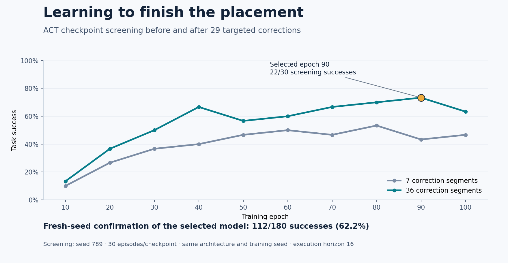
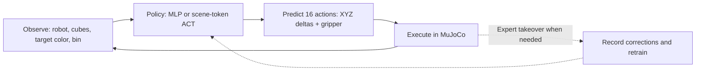

# Teaching a Robot to Pick and Place with Imitation Learning

A simulated SO-101 learns to grasp a requested cube and place it in a bin from
human demonstrations, then improves through expert corrections of its mistakes.

**97% original obstacle · 82% adversarial obstacle · 62.2% goal-conditioned multicube**

<table>
  <tr><th>Pick the red cube</th><th>Pick the green cube</th><th>Pick the blue cube</th></tr>
  <tr>
    <td><video src="https://github.com/user-attachments/assets/8ddb1500-b609-498f-8c5f-941b39e51fd0" controls width="100%"></video></td>
    <td><video src="https://github.com/user-attachments/assets/1c14e14e-9606-45e7-92d8-86a14f92a659" controls width="100%"></video></td>
    <td><video src="https://github.com/user-attachments/assets/17e24c62-0de9-4038-9a87-27f8c4b2eb87" controls width="100%"></video></td>
  </tr>
</table>

*Fully autonomous ACT rollouts · selected epoch 90 · execution horizon 16 ·
3× simulation speed · no human takeover.*

These are selected successful examples, one per target color, from seed 4242
(red: episode 7; green: episode 2; blue: episode 6). Aggregate confirmation
success is **112/180 (62.2%)**. [Recording metadata](media/act_videos.json)
records the checkpoint, source episodes and playback settings.

<details>
<summary>Earlier autonomous obstacle-policy videos (Exercise 2)</summary>

<table>
  <tr><th>Original obstacle</th><th>Adversarial obstacle</th></tr>
  <tr>
    <td><video src="https://github.com/user-attachments/assets/02367afa-1413-4170-b55e-8a3677b7aa2b" controls width="100%"></video></td>
    <td><video src="https://github.com/user-attachments/assets/fdb4ebec-4961-4789-94d9-8e88133557ca" controls width="100%"></video></td>
  </tr>
</table>

[Recording metadata](media/policy256_videos.json)

Both show the width-256 MLP, epoch 10, seed 987, episode 1, at 3× playback.

</details>

## Goal

**Can a policy trained from keyboard demonstrations learn reliable manipulation,
and can targeted human corrections help it recover when it makes mistakes?**

The lab progresses from one cube and an obstacle, to shifted obstacle placements,
to choosing among three colored cubes with randomized pickup and bin positions.
It is an independent learning project built on ETH Zürich's Robot Learning lab.

## Results

| Task | Policy and data | Confirmation success |
|---|---|---:|
| Single cube, original obstacle | Behavioral cloning MLP; 21 demonstrations | **61/100 — 61%** |
| Single cube, original obstacle | MLP + 24 DAgger corrections | **97/100 — 97%** |
| Single cube, shifted obstacle | Same MLP + 24 DAgger corrections | **82/100 — 82%** |
| Requested color, randomized cubes/bin | Scene-token ACT; 42 demonstrations + 36 corrections | **112/180 — 62.2%** |

These are different tasks and evaluation seeds, not one controlled benchmark:
baseline seed 123, corrected MLP seed 987, and final ACT seeds 4242/4243.
ACT scored 60.0% and 64.4% on those two seeds; by target color, red **66.7%**,
green **51.7%**, blue **68.3%**. All runs use an 800-step limit and execute
16 actions before replanning.



**What to notice:** after 29 targeted recovery segments were added, screening
improved from a best of **16/30 to 22/30**, with stronger performance across
several later checkpoints. Both curves use the same architecture, training seed,
screening seed and held-out original episodes. The selected epoch-90 model then
achieved **112/180 (62.2%) on fresh confirmation seeds**. Its 73.3% screening
score was used for checkpoint selection and is not the confirmation estimate.

[Full ACT report](docs/act.md) · [Experiment history](docs/experiment-log.md)
· [Published results: CSV](docs/results/act-dagger36.csv) / [JSON](docs/results/act-dagger36.json)

## Approach



Behavioral cloning learns action chunks from expert examples. DAgger-style human
takeovers add corrections from states the learner actually visits, including
recovery from poor bin approaches and incomplete releases.

The final ACT adaptation reads **25 numerical features**, including the target
cube and bin positions relative to the end effector. Eight scene tokens and a
latent token feed a **two-layer, width-256 transformer decoder with four heads**.
Sixteen learned queries produce the action chunk. A variational encoder learns
a 32-dimensional latent during training; execution uses a zero latent.
Training minimizes **normalized-action MSE + 0.1 × KL**, with about **3.74M
parameters**. [Architecture diagram and implementation details →](docs/act.md#architecture-and-learning)

## What I implemented

The course supplied the MuJoCo scenes, robot assets, teleoperation infrastructure,
data/evaluation utilities and policy/training templates. Building on those:

- **Policies and training:** implemented the MLP and state-based ACT models,
  scene-token decoder, reconstruction/KL losses, training and validation logic,
  and periodic checkpoints with architecture metadata.
- **Data and corrections:** collected and curated demonstrations, added episode
  filtering, shared goal-relative features and multicube DAgger takeover recording
  with separate contiguous expert segments and a settling countdown.
- **Evaluation and analysis:** compared network capacity and checkpoints,
  inspected grasp/release failures and layout coverage, tested recorded-action
  replay, and published per-color results and reproducible experiment reports.

## What worked and what failed

- **Correct the failure you observe.** Before the latest collection, 10 of 14
  failed screening rollouts reached the bin area without completing placement.
  Adding 29 curated recoveries while keeping the ACT settings fixed improved
  matched screening results. The earlier 38% confirmation used a different seed,
  so it is not a matched estimate of the increase to 62.2%.
- **Evaluate behavior, not just loss.** The selected ACT checkpoint is epoch 90
  with validation MSE 0.917494. Across the lab, lower validation loss and larger
  networks did not reliably produce better rollouts; a width-512 MLP performed
  worse than width 256 in the obstacle checkpoint comparison.
- **A plausible change can still fail.** Absolute-position ACT achieved **0/90**
  confirmation successes despite successful expert replay in three examples.
  We retained delta actions. Green remains the weakest goal in the final model.

## Run it

**Install** from the repository root (Python 3.12 was used locally):

```bash
python3.12 -m venv .venv
source .venv/bin/activate
python -m pip install -e .
```

**Datasets and checkpoints are not bundled.** A fresh clone can run teleoperation;
training and policy evaluation require your own collection or separately supplied
artifacts. Dependency versions are not locked. Start collecting with:

```bash
python -m scripts.record_teleop_demos --multicube
```

**Watch the selected ACT policy** when its checkpoint is available locally:

```bash
python -m scripts.eval \
  --checkpoint checkpoints/multi_cube/act_scene_dagger36_mse_kl01/epoch090_ee_xyz_act_scene_dagger36ep_width256.pt \
  --multicube --goal-cube all --execution-horizon 16 \
  --num-episodes 3 --max-steps 800 --seed 4242
```

For the confirmation evaluation, use `--num-episodes 90 --headless` and repeat
with seeds 4242 and 4243. On compatible Linux GPU setups, set `MUJOCO_GL=egl`
for headless rendering. Interactive recording/evaluation needs a graphical session.

<details>
<summary><strong>Train the final ACT configuration</strong></summary>

These paths refer to the locally curated and processed collection. For a new
collection, preprocess with `scripts/compute_actions.py` and use your own paths
and held-out episode IDs. The three stores are loaded in the listed order.

```bash
python -m scripts.train \
  --zarr datasets/processed/multi_cube/processed_ee_xyz.zarr \
  --extra-zarr datasets/processed/multi_cube/dagger_7_ee_xyz.zarr \
    datasets/processed/multi_cube/dagger_new29_ee_xyz.zarr \
  --policy act_scene --action-keys action_ee_xyz action_gripper \
  --d-model 256 --depth 2 --chunk-size 16 --kl-weight 0.1 \
  --seed 42 --val-episode-ids 36 9 32 \
  --checkpoint-dir checkpoints/multi_cube/act_scene_dagger36_mse_kl01
```

Training uses 100 epochs, Adam at 1e-4 with cosine decay to 1e-5, batch size 64,
and normalization fitted only on training rows. The original three validation
episodes remain held out; all correction segments enter training. Select among
periodic checkpoints on screening rollouts before running fresh-seed confirmation.

</details>

## Project structure

```text
hw3/           Policies, datasets, goal features and simulation interface
scripts/       record_teleop_demos.py · dagger_eval.py · compute_actions.py
               train.py · eval.py · filter_episodes.py
so101_gym/     Course robot scenes and assets
docs/          ACT report, experiment log and result tables
media/         Demonstrations, rollout videos and previews
```

## References

- [ETH Zürich Robot Learning — imitation-learning assignment](https://github.com/tenvinc/ethz-course-2026/tree/main/hw3_imitation_learning): starter code and course material.
- [Zhao et al., 2023 — Action Chunking with Transformers](https://arxiv.org/abs/2304.13705): algorithm reference; this project uses a state-based adaptation.
- [Ross et al., 2011 — DAgger](https://arxiv.org/abs/1011.0686): dataset aggregation and learning from learner-visited states.
- [SO-ARM100](https://github.com/TheRobotStudio/SO-ARM100): robot asset source; bundled asset licensing is preserved.

See [sources and license status](THIRD_PARTY.md). This is an independent study,
not an official ETH project. The course code retains its original authorship;
no blanket license is assigned to the supplied material.
