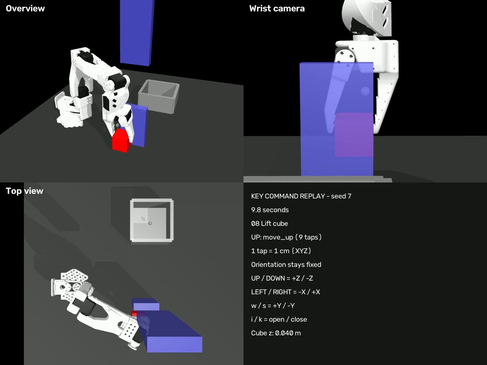

# SO-101 Behavioral Cloning Lab

Learning robot pick-and-place from human demonstrations in MuJoCo, building on
the [ETH Zürich Robot Learning imitation-learning assignment](https://github.com/tenvinc/ethz-course-2026/tree/main/hw3_imitation_learning).

**Work in progress:** demonstration collection and filtering are complete.
The behavior-cloning policy and training loop still need implementation; no
learned-policy success rate has been measured.



[Watch the 24-second keyboard demonstration](media/keyboard-demo.mp4) ·
[Movement keys and timings](media/keyboard-demo-keys.csv)

This video replays the simulator's keyboard commands with fixed gripper
orientation. It demonstrates a route around the obstacle and release into the
bin. It is a teleoperation reference, not a trained-policy rollout.

## The experiment

The task is to grasp a cube, carry it around an obstacle, and release it into a
bin. The initial baseline will use behavior cloning: supervised learning that
maps an observation to a short sequence of demonstrated actions.

| Component | Initial baseline plan |
|---|---|
| Observation | EE XYZ (3), gripper opening (1), cube XYZ (3), obstacle XYZ (3) |
| Action | EE XYZ deltas (3), absolute gripper control (1) |
| Policy | MLP predicting an action chunk |
| Loss | Mean squared error on normalized actions |
| Validation | Hold out entire demonstration episodes |
| Evaluation | Visual rollouts, then success rate over 100 episodes |

The current cleaned collection contains **21 of 22 demonstrations**. Original
episode 13 was excluded because the cube was not released. See
[data selection](configs/data_selection.json) and
[experiment log](docs/experiment-log.md).

## Setup

From the repository directory:

```bash
uv venv --python 3.12
source .venv/bin/activate
uv pip install -e .
```

The MuJoCo teleoperation viewer requires a graphical session. Package versions
are not locked yet; a tested environment will be recorded with the baseline.

## Collect and prepare demonstrations

```bash
python scripts/configure_keys.py
python scripts/record_teleop_demos.py
```

Space toggles recording; Enter saves an episode and resets; R discards the
current recording and resets; Escape saves any active episode and exits.
Complete the release and allow the cube to settle before ending an episode.
The raw key codes in `hw3/keymap.json` determine the actual bindings.

For the existing local collection, the cleaned copy is already available.
To recreate that copy from the original session:

```bash
python scripts/filter_episodes.py \
  --input datasets/raw/single_cube/teleop/2026-10-08_14-14-25/so100_transfer_cube_teleop.zarr \
  --output datasets/curated/single_cube/teleop/successful_demos.zarr \
  --exclude-episodes 13
```

The filter preserves the original store and refuses to overwrite an existing
output. The date-stamped input path is specific to this local collection.

Next, compute XYZ delta targets:

```bash
python scripts/compute_actions.py \
  --action-space ee \
  --datasets-dir datasets/curated/single_cube
```

This step has not yet been run in the portfolio repository. It produces
`datasets/processed/single_cube/processed_ee_xyz.zarr`.
Demonstrations and checkpoints are excluded from Git. A fresh clone requires
its own demonstration collection or a separately supplied dataset.

## Remaining work

- Implement `ObstaclePolicy` and complete the training script.
- Split by episode and fit normalization using training episodes only.
- Train and record the configuration, losses, and checkpoint.
- Evaluate rollouts and analyze failures.
- Explore DAgger after establishing the behavior-cloning baseline.

Training commands and results will be added when they have been verified.

## Attribution

The simulator and supporting course infrastructure come from the ETH Zürich
Robot Learning assignment. Demonstration collection, episode curation, added
utilities, and experiments are documented separately from the supplied code.

See [sources and license status](THIRD_PARTY.md). The original course repository
is [tenvinc/ethz-course-2026](https://github.com/tenvinc/ethz-course-2026). The bundled
robot model's Apache-2.0 license is preserved. The course repository does not
provide a top-level license; its code retains its original authorship, and this
repository does not assign a new blanket license to the supplied material.
