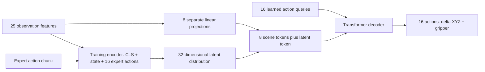

# Goal-conditioned ACT: architecture and experiments

The task is to pick the requested red, green or blue cube and drop it into a
randomly positioned bin. This implementation adapts Action Chunking with
Transformers (ACT) to the course simulator's numerical observations.
Algorithm reference: [Zhao et al., 2023](https://arxiv.org/abs/2304.13705).

## Observation and action design

| Feature group | Dimensions |
|---|---:|
| End-effector XYZ and measured gripper opening | 4 |
| Current red, green and blue cube XYZ, separately | 3 + 3 + 3 |
| Requested color, one-hot | 3 |
| Bin XYZ | 3 |
| Requested cube XYZ minus EE XYZ | 3 |
| Bin XYZ minus EE XYZ | 3 |
| **Total** | **25** |

Despite their `original_pos_cube_*` processed-array names, cube features contain
current recorded/live positions. The shared `hw3/goal_features.py` computes
relative features consistently for offline data and live observations. Inputs
and actions are standardized using training rows only.

The output is `(batch, 16, 4)`: 16 successive EE XYZ deltas and absolute gripper
commands. During execution, each delta is added to the accumulated mocap target.
All 16 actions execute before the next observation is used for prediction;
there is no temporal ensemble in this implementation.

## Architecture and learning

`ACTPolicy` implements a conditional variational action-chunk model;
`ACTScenePolicy` specializes its decoder context into scene tokens.



Each of eight scene groups is projected to width 256. Learned role embeddings
identify their positions in the context; the projected latent is its ninth
token. Sixteen learned action queries attend to this context through a two-layer
transformer decoder, followed by a linear four-value action head. The model has
3,739,972 parameters.

During training, a separate two-layer transformer encoder reads a learned CLS
token, the projected full observation and the 16 expert-action tokens, with
learned positional embeddings. Its CLS output predicts the mean and log
variance of a 32-dimensional diagonal Gaussian. Reparameterization samples a
latent while allowing backpropagation. Both transformers use four attention
heads, feed-forward width 1024, GELU and dropout 0.1.

The objective is `MSE(predicted normalized actions, expert normalized actions)
+ 0.1 * KL(q(z | observation, expert actions) || N(0, I))`. KL sums over latent
dimensions and averages over the batch. At inference, expert actions are
unavailable: the policy uses a zero latent, disables dropout and predicts its
chunk deterministically. Validation evaluates this zero-latent prediction with
MSE. Small KL alone is not evidence that the model resolves different possible
expert behaviors.

This is a state-based adaptation with MSE and delta XYZ actions. It does not
reproduce the original ACT training/control setup or use camera-image features.

## Development and DAgger

The MLP baseline, relative features, model-capacity tests and grasp diagnostics
are recorded in [the experiment log](experiment-log.md). The initial flat-state
ACT with L1 reconstruction barely moved in observed rollouts. MSE restored more
useful movement; reducing KL weight to 0.1 and separating decoder scene tokens
led to the retained reference model. These sequential experiments are not a
complete controlled ablation of every design choice.

Before the latest collection, the scene-token delta model selected epoch 80:
16/30 screening successes (seed 789), then 34/90 (seed 2026). Switching to
absolute future EE positions gave 4/30 screening and 0/90 confirmation, despite
successful expert replay in three checked demonstrations. Delta actions were
therefore retained. The precise cause of the absolute-policy failure remains
unresolved.

A repeated diagnostic of the delta model found 10 of 14 failures reached the
bin's horizontal area without completing placement. That motivated human
takeovers around approach, centering and release, plus pickup/transport recovery
when needed. This geometric categorization does not establish the exact cause.

The latest collection retained **29 new corrections: 8 red, 10 green, 11 blue**.
Two incomplete blue segments were excluded from a curated copy; raw recordings
remain intact. Retained endings contained 17 recorded steps with the target
geometrically inside the bin. This alone does not prove release from the claw.
The recorder now restarts its settling timer if the cube leaves the bin.
Contiguous human-control segments are saved separately so learner-controlled
gaps cannot become synthetic expert deltas.

New corrections added 1,473 transitions and 1,038 complete 16-step chunks.
The full collection is **42 original demonstrations + 36 correction segments**
(7 earlier + 29 new): 78 episodes/segments, 13,074 transitions. Original
zero-based validation episodes `[36, 9, 32]` remain held out. The other 75
segments train: 11,165 chunks, versus 739 validation chunks.

Training retained width 256, depth 2, KL weight 0.1, horizon 16, seed 42 and
100 epochs. Adam uses learning rate 1e-4 with cosine decay to 1e-5, batch size 64.
Training starts from scratch. Checkpoints are selected using rollout success,
rather than minimum validation MSE.

## Screening and independent confirmation

All screening runs use seed 789, 30 episodes, equal requested-color counts,
an 800-step limit and execution horizon 16.

| Epoch | Overall | Red | Green | Blue |
|---:|---:|---:|---:|---:|
| 10 | 4/30 | 0/10 | 2/10 | 2/10 |
| 20 | 11/30 | 2/10 | 5/10 | 4/10 |
| 30 | 15/30 | 3/10 | 3/10 | 9/10 |
| 40 | 20/30 | 6/10 | 7/10 | 7/10 |
| 50 | 17/30 | 6/10 | 6/10 | 5/10 |
| 60 | 18/30 | 6/10 | 5/10 | 7/10 |
| 70 | 20/30 | 6/10 | 5/10 | 9/10 |
| 80 | 21/30 | 7/10 | 7/10 | 7/10 |
| 90 | 22/30 | 7/10 | 7/10 | 8/10 |
| 100 | 19/30 | 6/10 | 6/10 | 7/10 |

Epoch **90** was selected before the following fresh-seed confirmation runs.
Its validation MSE is **0.917494**; lower offline error is not a reliable task-
success ranking in these experiments.

| Confirmation seed | Overall | Red | Green | Blue |
|---:|---:|---:|---:|---:|
| 4242 | 54/90 (60.0%) | 17/30 | 15/30 | 22/30 |
| 4243 | 58/90 (64.4%) | 23/30 | 16/30 | 19/30 |
| **Combined** | **112/180 (62.2%)** | **40/60 (66.7%)** | **31/60 (51.7%)** | **41/60 (68.3%)** |

The matched screening score improved from 16/30 to 22/30 with the added data.
Earlier confirmation was 34/90 on a different seed, so comparison with 62.2%
does not isolate an exact causal improvement. There is one training seed and
two new confirmation seeds; these results do not establish performance for all
layouts or training runs. Green remains the weakest goal. The 73% screening
score was used for selection and should not replace the 62.2% confirmation score.

The course describes performance approaching 50% as very strong, rather than a
maximum. The current observed confirmation result exceeds that milestone.

Counts extracted from retained logs are published as
[CSV](results/act-dagger36.csv) and [JSON](results/act-dagger36.json). JSON includes
checkpoint metadata and hashes of source logs; datasets, raw logs and weights
remain local ignored artifacts. A fresh clone requires separately supplied
data/checkpoints or a new collection and training run.

## Reproduce training and evaluation

From the repository root with the project environment activated:

```bash
python -u scripts/train.py \
  --zarr datasets/processed/multi_cube/processed_ee_xyz.zarr \
  --extra-zarr datasets/processed/multi_cube/dagger_7_ee_xyz.zarr \
    datasets/processed/multi_cube/dagger_new29_ee_xyz.zarr \
  --policy act_scene --action-keys action_ee_xyz action_gripper \
  --d-model 256 --depth 2 --chunk-size 16 --kl-weight 0.1 \
  --seed 42 --val-episode-ids 36 9 32 \
  --checkpoint-dir checkpoints/multi_cube/act_scene_dagger36_mse_kl01

MUJOCO_GL=egl OMP_NUM_THREADS=1 MKL_NUM_THREADS=1 \
python -u scripts/eval.py \
  --checkpoint checkpoints/multi_cube/act_scene_dagger36_mse_kl01/epoch090_ee_xyz_act_scene_dagger36ep_width256.pt \
  --multicube --goal-cube all --execution-horizon 16 \
  --num-episodes 90 --max-steps 800 --headless --seed 4242
```

Repeat evaluation with seed 4243. Headless EGL requires a compatible graphics
environment. Training saves metadata needed to rebuild the architecture and
normalization during evaluation.

## Autonomous video examples

Recorded the first successful episode of each requested color from the saved
seed-4242 confirmation log: green episode 2 (202 steps), blue episode 6 (400
steps), red episode 7 (302 steps). All three successes reproduced with the
selected epoch-90 checkpoint, CUDA inference and horizon 16 through the existing
evaluation loop. No expert takeover or additional robot actions were applied.

Each MP4 plays at 3× speed (10 control frames/s encoded at 30 fps) with a
20-frame final-image hold. They are selected successful examples, not an
estimate of success rate. Checkpoint hash and capture metadata are recorded in
[media/act_videos.json](../media/act_videos.json). The capture can be reproduced
with `python -m scripts.record_act_videos` in a compatible headless EGL setup;
the script refuses to overwrite existing final MP4s.
